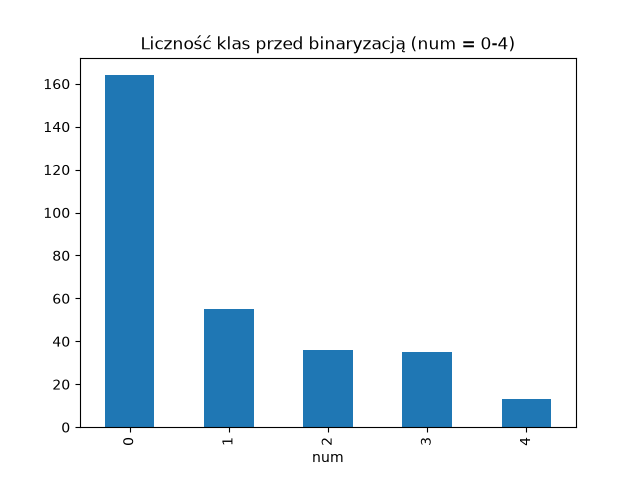
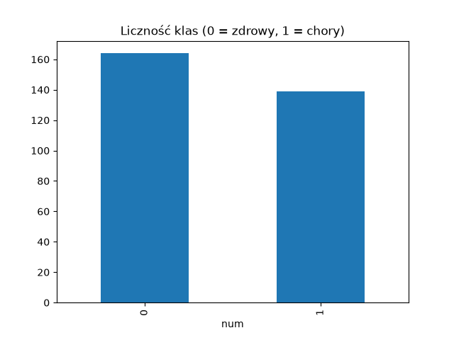
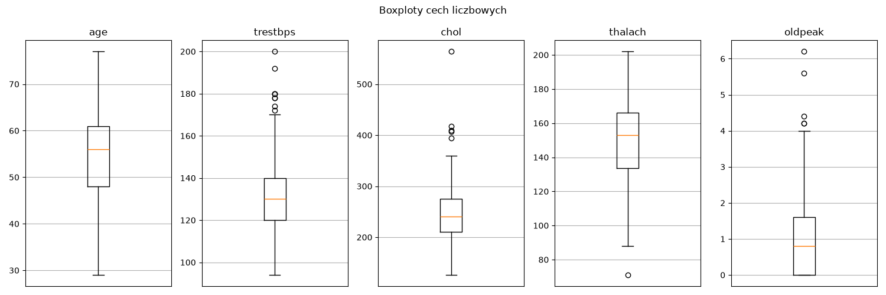
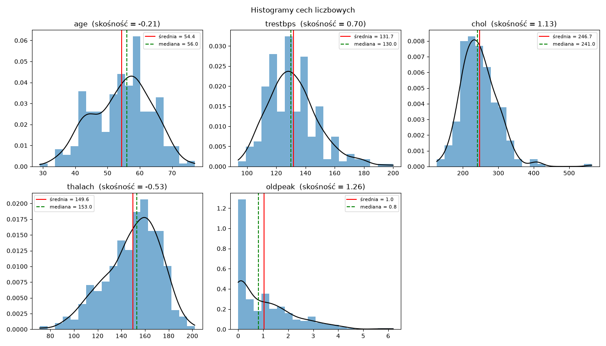
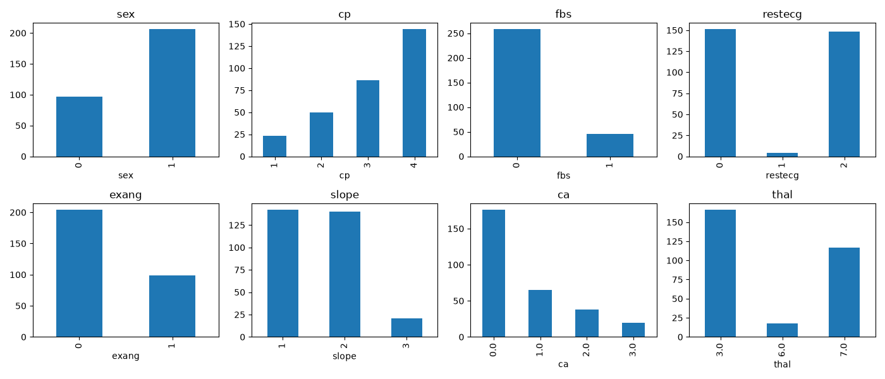
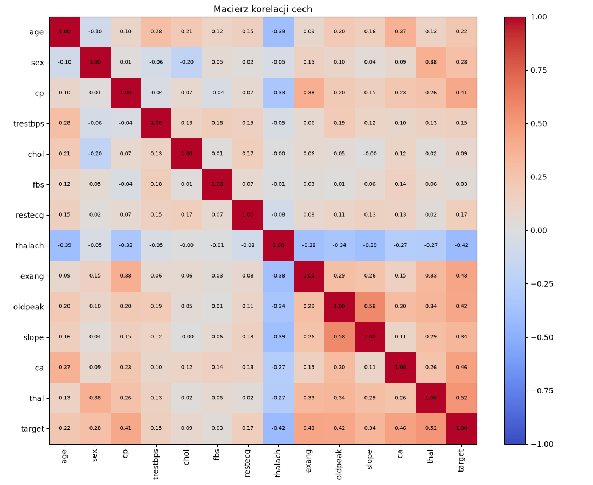
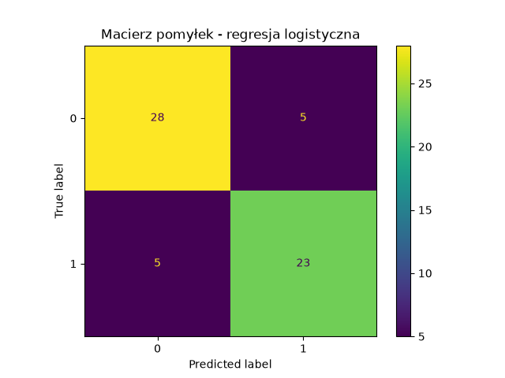
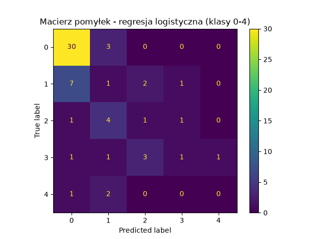

# Sieci neuronowe – ćwiczenie 1: raport

**Zbiór:** Heart Disease (UCI, id=45), 303 próbki, 13 cech.
**Kod:** `lab1.py`. wykresy  w folderze `wykresy/`.

Podział cech:
- **liczbowe:** age, trestbps, chol, thalach, oldpeak
- **kategoryczne:** sex, cp, fbs, restecg, exang, slope, ca, thal

## 1. Czy zbiór jest zbalansowany?

| Klasa (num) | 0 | 1 | 2 | 3 | 4 |
|---|---|---|---|---|---|
| Liczba próbek | 164 | 55 | 36 | 35 | 13 |

W oryginalnej postaci (5 klas) zbiór jest **niezbalansowany**, bo klasa 4 ma tylko 13 próbek.

Klasy 1–4 oznaczają różne stopnie choroby, więc łączymy je w jedną klasę „chory”:

| Klasa | 0 – zdrowy | 1 – chory |
|---|---|---|
| Liczba próbek | 164 (54%) | 139 (46%) |

Po binaryzacji zbiór jest **w przybliżeniu zbalansowany**.

## 2. Średnie i odchylenia cech liczbowych

| Cecha | Średnia | Odch. std. |
|---|---|---|
| age | 54.44 | 9.04 |
| trestbps | 131.69 | 17.60 |
| chol | 246.69 | 51.78 |
| thalach | 149.61 | 22.88 |
| oldpeak | 1.04 | 1.16 |

Cechy mają bardzo różne skale (np. chol ok. 250, oldpeak ok. 1), więc trzeba je znormalizować.
Widać to na boxplotach poniżej: każda cecha ma własną oś Y, a zakresy wartości są zupełnie różne (chol ok. 130–560, oldpeak ok. 0–6).

## 3. Czy cechy liczbowe mają rozkład normalny?

Test Shapiro-Wilka: dla wszystkich cech p < 0.05, więc formalnie **żadna nie ma rozkładu normalnego**.
Na histogramy naniesiono krzywą gęstości (czarna), średnią (czerwona) i medianę (zielona przerywana).

| Cecha | Średnia | Mediana | Skośność | Kształt |
|---|---|---|---|---|
| age | 54.4 | 56.0 | −0.21 | prawie symetryczny, lekko lewoskośny |
| trestbps | 131.7 | 130.0 | 0.70 | prawoskośny |
| chol | 246.7 | 241.0 | 1.13 | prawoskośny (długi ogon do 564) |
| thalach | 149.6 | 153.0 | −0.53 | lewoskośny |
| oldpeak | 1.0 | 0.8 | 1.26 | silnie prawoskośny, większość wartości = 0 |

Wniosek: age, trestbps, chol i thalach są **w przybliżeniu normalne**, ale **oldpeak wyraźnie nie jest normalny.**

## 4. Czy cechy kategoryczne mają rozkład równomierny?

Test chi-kwadrat względem rozkładu równomiernego: dla wszystkich cech p < 0.05, więc **żadna nie ma rozkładu równomiernego**.

| Cecha | Liczności kategorii |
|---|---|
| sex | 0: 97, 1: 206 |
| cp | 1: 23, 2: 50, 3: 86, 4: 144 |
| fbs | 0: 258, 1: 45 |
| restecg | 0: 151, 1: 4, 2: 148 |
| exang | 0: 204, 1: 99 |
| slope | 1: 142, 2: 140, 3: 21 |
| ca | 0: 176, 1: 65, 2: 38, 3: 20 |
| thal | 3: 166, 6: 18, 7: 117 |

Najbardziej nierównomierne są fbs, restecg (kategoria 1 ma tylko 4 próbki) i thal.

## 5. Brakujące wartości

| Cecha | Liczba braków |
|---|---|
| ca | 4 |
| thal | 2 |

Braków jest tylko 6 (ok. 2% wierszy) i występują wyłącznie w cechach kategorycznych.
Zastosowana strategia: **uzupełnienie dominantą**, czyli najczęstszą wartością (ca = 0, thal = 3).
Inne możliwości to usunięcie tych 6 wierszy albo dodanie osobnej kategorii „brak”.

### Macierz korelacji cech

Korelacja Pearsona od −1 do 1 między wszystkimi cechami i targetem (0 = zdrowy, 1 = chory). Czerwony kolor oznacza zależność dodatnią, a niebieski ujemną.

- **Najsilniej z targetem korelują:** thal (0.52), ca (0.46), exang (0.43), oldpeak (0.42), cp (0.41) i thalach (−0.42). Ujemny znak przy thalach oznacza, że niższe maksymalne tętno idzie w parze z chorobą.
- **Najsłabiej z targetem korelują:** fbs (0.03) i chol (0.09), więc mają mało informacji o klasie.
- **Między cechami** najsilniejsza zależność to oldpeak–slope (0.58). Żadna para nie przekracza ~0.6, czyli cechy nie są silnie redundantne.

## 6. Kodowanie i normalizacja

Klasyfikatory liniowe i sieci neuronowe wymagają liczb rzeczywistych o podobnej skali, dlatego:
1. **Cechy kategoryczne → one-hot encoding**: każda kategoria dostaje osobną kolumnę 0/1. Po kodowaniu mamy 28 cech.
2. **Podział train/test** w proporcji 80/20 ze stratyfikacją (242 / 61 próbek).
3. **Cechy liczbowe → standaryzacja** `(x − średnia) / odchylenie`. Parametry liczymy tylko na zbiorze treningowym, żeby nie przeciekała informacja ze zbioru testowego.

## 7. Baseline

Klasyfikator: **regresja logistyczna** (`sklearn.linear_model.LogisticRegression`), czyli prosty model liniowy.

| Metryka | Wynik |
|---|---|
| Accuracy | **0.836** |
| F1-score | **0.821** |

Macierz pomyłek (wiersze: prawdziwa klasa, kolumny: predykcja):

|  | pred. 0 | pred. 1 |
|---|---|---|
| **zdrowy (0)** | 28 | 5 |
| **chory (1)** | 5 | 23 |

### Baseline dla targetu przed binaryzacją (klasy 0–4)

Ten sam model i to samo przygotowanie danych, ale z oryginalnym targetem `num` (5 klas).

| Metryka | Wynik |
|---|---|
| Accuracy | **0.541** |
| F1-score (macro) | **0.253** |

|  | pred. 0 | pred. 1 | pred. 2 | pred. 3 | pred. 4 |
|---|---|---|---|---|---|
| **0** | 30 | 3 | 0 | 0 | 0 |
| **1** | 7 | 1 | 2 | 1 | 0 |
| **2** | 1 | 4 | 1 | 1 | 0 |
| **3** | 1 | 1 | 3 | 1 | 1 |
| **4** | 1 | 2 | 0 | 0 | 0 |

Klasę 0 model rozpoznaje dobrze (30 z 33). Klasy 1–4 mają w zbiorze testowym tylko 3–11 próbek i są często mylone ze sobą, a klasy 4 nie trafiono ani razu. Dlatego F1 macro jest niskie, a binaryzacja daje dużo lepszy i bardziej sensowny baseline.

## Wnioski

- Po połączeniu klas 1–4 zbiór jest w przybliżeniu zbalansowany.
- Cechy liczbowe mają różne skale i nie są idealnie normalne, więc standaryzacja jest konieczna.
- Cechy kategoryczne są nierównomierne i zakodowano je metodą one-hot.
- Kilka braków (ca, thal) uzupełniono dominantą.
- **Baseline do dalszych porównań: accuracy ≈ 0.836 (regresja logistyczna, 2 klasy).** Dla 5 klas: accuracy ≈ 0.541, F1 macro ≈ 0.253. 
