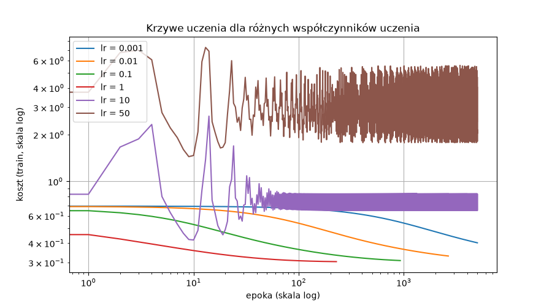
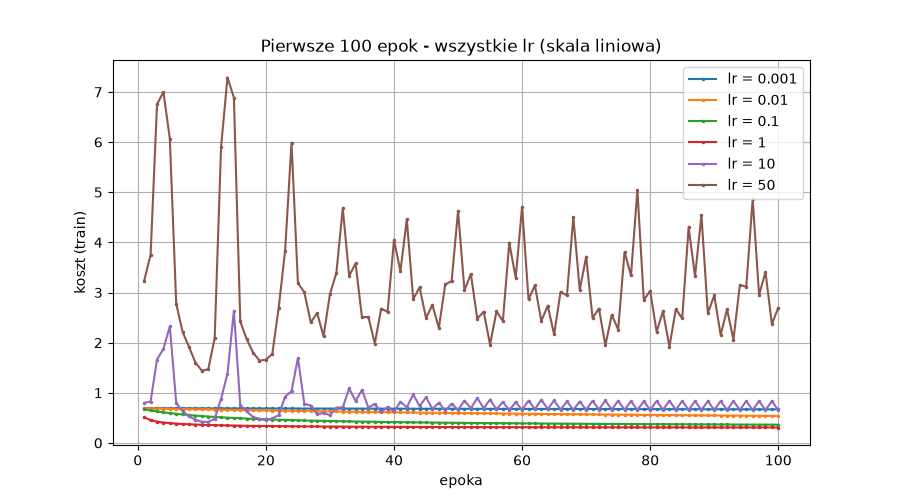
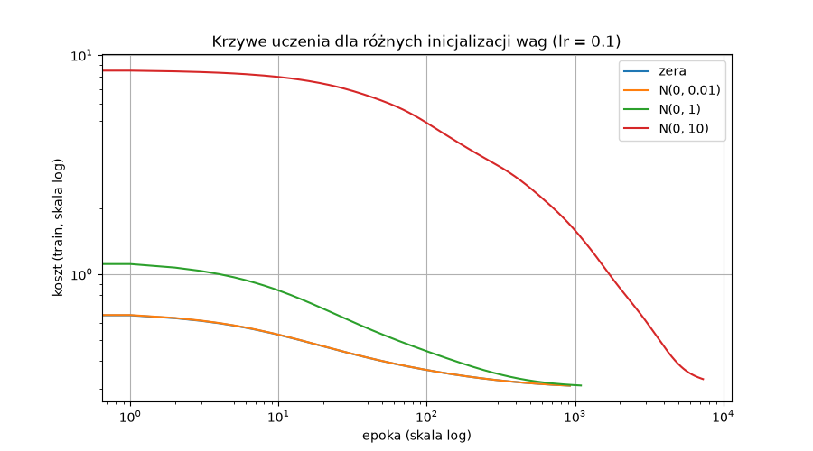
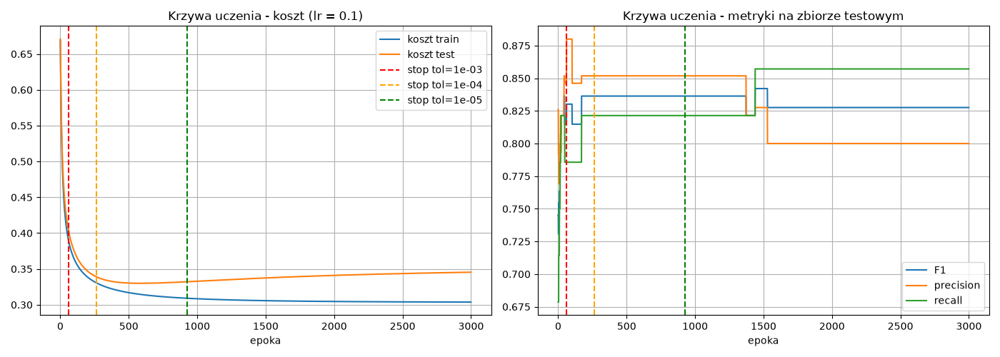

# Sieci neuronowe – ćwiczenie 2: raport

## 1. Dane i model

**Przygotowanie danych** jest takie samo jak w lab1:
- target binarny: 0 = zdrowy, 1 = chory
- braki uzupełnione dominantą
- cechy kategoryczne zakodowane one-hot (28 cech)
- cechy liczbowe standaryzowane
- podział 80/20, czyli 242 próbki treningowe i 61 testowych.

**Model** (wszystko zaimplementowane ręcznie w numpy):
- wyjście: p(x) = σ(Wx + b), gdzie σ(z) = 1 / (1 + e⁻ᶻ)
- koszt: entropia krzyżowa L = −y ln p − (1−y) ln(1−p), uśredniona po próbkach
- gradient: ∂L/∂wᵢ = −(y − p(x)) xᵢ
- aktualizacja wag: wᵢ ← wᵢ − α · ∂L/∂wᵢ. W każdej epoce liczymy gradient na całym zbiorze treningowym
- warunek stopu: przerywamy, gdy koszt zmieni się o mniej niż tol między epokami

Metryki precision, recall i F1 liczone są na zbiorze testowym, przy progu klasyfikacji 0.5.

## 2. Wpływ współczynnika uczenia (α)

Inicjalizacja wag: zera. Stop przy tol = 1e-5, maksymalnie 5000 epok.

| α | Epoki do zbieżności | Koszt końcowy (train) | F1 | Precision | Recall |
|---|---|---|---|---|---|
| 0.001 | 5000 (nie zbiegł) | 0.402 | 0.815 | 0.846 | 0.786 |
| 0.01 | 2647 | 0.331 | 0.836 | 0.852 | 0.821 |
| 0.1 | 925 | 0.309 | 0.836 | 0.852 | 0.821 |
| 1 | **229** | **0.304** | 0.828 | 0.800 | 0.857 |
| 10 | 5000 (oscyluje) | 0.651 | 0.765 | 0.650 | 0.929 |
| 50 | 5000 (oscyluje) | 2.141 | 0.769 | 0.833 | 0.714 |

Pierwsze 100 epok w skali liniowej, z kosztem w każdej epoce:

- **Za małe α (0.001, 0.01):** koszt cały czas spada w dobrą stronę, ale bardzo wolno. Przy α = 0.001 model nie zdążył zbiec w 5000 epokach. Problem tylko **przedłuża uczenie**.

  Linia α = 0.001 kończy się na wykresie w epoce 5000, bo zatrzymał ją limit epok, a nie warunek stopu. Gdy uczono ją dalej, bez limitu, koszt spadał tak:

  | Epoka | Koszt train |
  |---|---|
  | 5 000 | 0.402 (koniec na wykresie) |
  | 10 000 | 0.365 |
  | 20 000 | 0.339 |
  | 50 000 | 0.317 |
  | ~92 400 | 0.309 (tyle co α = 0.1 po 925 epokach) |

  Model z α = 0.001 dochodzi więc do tego samego minimum co pozostałe, tylko potrzebuje ok. **100 razy więcej epok** niż α = 0.1.
- **Dobre α (0.1–1):** szybka i gładka zbieżność do minimum kosztu ≈ 0.304–0.309.
- **Za duże α (10, 50):** krok jest tak duży, że model „przeskakuje” minimum. Koszt skacze i nigdy się nie ustabilizuje.

## 3. Wpływ inicjalizacji wag

α = 0.1, stop przy tol = 1e-5.

| Inicjalizacja | Epoki | Koszt początkowy | Koszt końcowy | F1 |
|---|---|---|---|---|
| zera | 925 | 0.669 | 0.309 | 0.836 |
| N(0, 0.01) | 925 | 0.671 | 0.309 | 0.836 |
| N(0, 1) | 1098 | 1.155 | 0.310 | 0.836 |
| N(0, 10) | 7309 | 8.551 | 0.331 | 0.800 |

- Zera i małe losowe wagi dają praktycznie identyczny przebieg.
- **Duże wagi początkowe (N(0, 10))** sprawiają, że na starcie model jest bardzo pewny złych odpowiedzi, a koszt wynosi 8.55. Uczenie trwa wtedy ok. 8 razy dłużej.
- Warunek stopu zatrzymał N(0, 10) przy koszcie 0.331, a nie 0.309, bo koszt spadał już powoli. Gdy uczenie przedłużono (tol = 1e-7), model z N(0, 10) doszedł do kosztu **0.304**, czyli do tego samego minimum co pozostałe.
- Wniosek: zła inicjalizacja w modelu liniowym **tylko przedłuża uczenie**. Funkcja jest wypukła, więc każdy start prowadzi do tego samego globalnego minimum.

## 4. Liczba epok i warunek stopu: krzywa uczenia

α = 0.1, inicjalizacja zerami, 3000 epok bez warunku stopu. Przerywane linie pokazują, gdzie zatrzymałyby uczenie różne warunki stopu.

| tol | Stop po epokach | Koszt test | F1 |
|---|---|---|---|
| 1e-3 | 59 | 0.406 | 0.815 |
| 1e-4 | 265 | 0.339 | 0.836 |
| 1e-5 | 925 | 0.332 | 0.836 |

- **Koszt na zbiorze treningowym** spada przez cały czas, coraz wolniej.
- **Koszt na zbiorze testowym** jest najmniejszy około epoki 588 (0.330), a potem powoli rośnie (0.345 po 3000 epokach). To lekkie **przeuczenie**: model coraz lepiej dopasowuje się do zbioru treningowego kosztem testowego.
- **Metryki** (F1, precision, recall) ustalają się już po ok. 200 epokach. Dalsze uczenie prawie ich nie zmienia, a po ~1500 epokach F1 nawet lekko spada (0.836 → 0.828).
- **Warunek stopu:**
  - tol = 1e-3 zatrzymuje uczenie za wcześnie i model jest niedouczony;
  - tol = 1e-4 i 1e-5 dają dobry wynik;
  - zbyt długie uczenie nic nie daje, a nawet lekko szkodzi.

## 5. Wynik końcowy

Model: α = 0.1, inicjalizacja zerami, tol = 1e-5 (925 epok).

| Metryka | Własna regresja logistyczna | Baseline sklearn (lab1) |
|---|---|---|
| Accuracy | 0.852 | 0.836 |
| Precision | 0.852 | – |
| Recall | 0.821 | – |
| F1 | **0.836** | 0.821 |

Własna implementacja osiąga wynik porównywalny z `LogisticRegression` ze scikit-learn, a nawet nieco lepszy.

## Wnioski: czy klasyfikator liniowy zawsze zbiega do globalnego minimum?

- **Funkcja kosztu regresji logistycznej jest wypukła**, więc nie ma minimów lokalnych, w których gradient mógłby „utknąć”. Przy rozsądnych parametrach model zawsze do niego dochodzi, niezależnie od startu: wszystkie udane przebiegi kończą z kosztem ≈ 0.304–0.31 i F1 ≈ 0.83.
- **Mogą jednak pojawić się problemy przez złą parametryzację:**
  - **za duży współczynnik uczenia** (α ≥ 10) **całkowicie uniemożliwia zbieżność**: koszt oscyluje i jakość jest wyraźnie gorsza;
  - **za mały współczynnik uczenia** i **zła (duża) inicjalizacja** **tylko przedłużają uczenie**: model dalej dąży do tego samego minimum, ale potrzebuje wielokrotnie więcej epok;
  - **zły warunek stopu** może przerwać uczenie za wcześnie (niedouczenie). Za późny stop marnuje czas, a na danych testowych daje lekkie przeuczenie.
