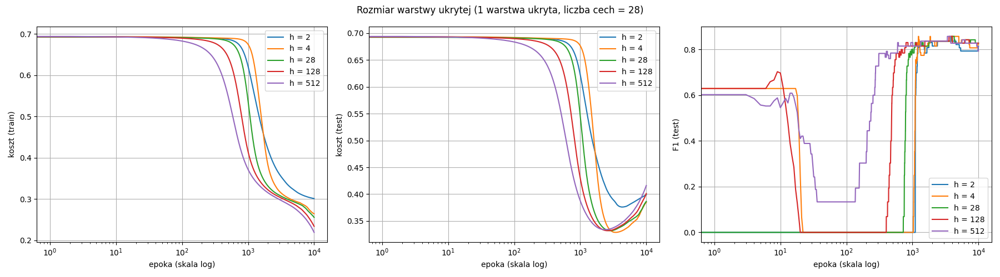
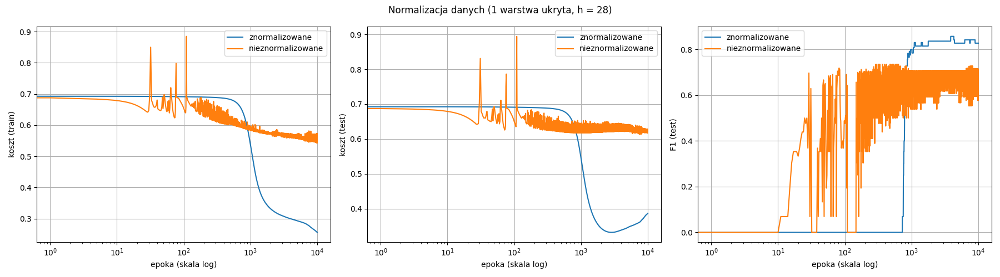
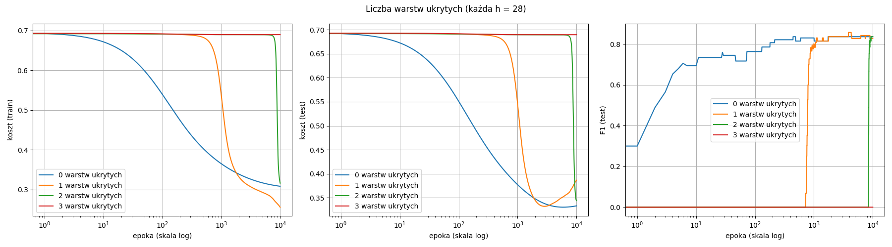

# Sieci neuronowe – ćwiczenie 3: raport

## 1. Zadanie i model

Zadanie polega na zbudowaniu wielowarstwowej sieci neuronowej (MLP) uczonej **propagacją wsteczną**:
- funkcja aktywacji ReLU w warstwach ukrytych;
- na wyjściu sigmoid i koszt jak w regresji logistycznej (entropia krzyżowa);
- wagi inicjalizowane z N(0, 0.01), współczynnik uczenia 0.01.

**Dane** są przygotowane tak samo jak w lab1/lab2:
- target binarny: 0 = zdrowy, 1 = chory;
- braki uzupełnione dominantą, cechy kategoryczne zakodowane one-hot (28 cech);
- podział 80/20, czyli 242 próbki treningowe i 61 testowych.

**Implementacja** (`lab3.py`, sam numpy): sieć to sekwencja modułów i każdy ma dwie funkcje:
- `forward(x)` liczy wyjście i zapamiętuje wejście x;
- `backward(dL/dy)` dostaje informację, jak koszt zależy od wyjścia modułu, i zwraca, jak koszt zależy od jego wejścia (dL/dx).
  Moduł z wagami zapisuje przy tym też gradient dL/dW.

| Moduł | forward | backward |
|---|---|---|
| `Linear` | y = Wx + b | dL/dx = dL/dy · W, gradient: dL/dW = (dL/dy)ᵀ · x |
| `ReLU` | max(0, x) | dL/dy · (1 gdy x > 0, inaczej 0) |
| `Sigmoid` | σ(x) | dL/dy · σ(x)(1 − σ(x)) |
| `BCELoss` | −y ln p − (1−y) ln(1−p) | dL/dp = (p − y) / (p(1 − p)) |

Moduły `MLP` układa w kolejności `[Linear → ReLU] × liczba warstw ukrytych → Linear → Sigmoid`.

**Jedna epoka uczenia** wygląda tak:
1. forward na całym zbiorze treningowym, tak jak w lab2;
2. backward od kosztu do pierwszej warstwy;
3. aktualizacja W ← W − 0.01 · dL/dW;

Uczenie trwa **10 000 epok**. Przy lr = 0.01 i wagach z N(0, 0.01) sieć potrzebuje ok. 1000 epok, zanim w ogóle zacznie się uczyć (patrz wykresy).
Metryki liczone są na zbiorze testowym po ostatniej epoce.

Sprawdzenie poprawności: sieć z **0 warstwami ukrytymi** to po prostu regresja logistyczna. Dała F1 = 0.836,
czyli dokładnie tyle co własna regresja logistyczna z lab2.

## 2. Eksperyment 1: rozmiar warstwy ukrytej (h)

Jedna warstwa ukryta z h neuronami. Liczba cech wynosi 28.

| h | Koszt train | Koszt test | Min. koszt test (epoka) | Accuracy | F1 |
|---|---|---|---|---|---|
| 2 (znacznie mniej niż cech) | 0.301 | 0.399 | 0.376 (4245) | 0.820 | 0.814 |
| 4 (znacznie mniej niż cech) | 0.264 | 0.385 | 0.329 (3431) | 0.836 | 0.821 |
| 28 (= liczba cech) | 0.256 | 0.386 | 0.332 (2862) | 0.836 | **0.828** |
| 128 (znacznie więcej niż cech) | 0.234 | 0.401 | 0.332 (2608) | 0.836 | **0.828** |
| 512 (znacznie więcej niż cech) | 0.219 | 0.416 | 0.334 (2368) | 0.803 | 0.793 |

- **Na początku jest plateau.** Przez kilkaset epok koszt stoi na ln 2 ≈ 0.69, czyli na poziomie zgadywania. Wagi są
  tak małe (0.01), że sygnał przechodzący przez dwie warstwy jest bardzo słaby, więc gradienty też są bardzo małe.
- **Im większe h, tym wcześniej sieć wychodzi z plateau:** przy h = 512 po ok. 300 epokach, przy h = 2 po ok. 1000.
  Neuron wyjściowy sumuje wyniki h neuronów ukrytych, więc przy większym h jego sygnał jest silniejszy.
- **Im większe h, tym niższy koszt treningowy** (0.301 → 0.219). Większa sieć ma więcej wag, więc lepiej dopasowuje się do zbioru treningowego.
- **Większe h nie daje lepszego wyniku na teście.** Koszt testowy osiąga minimum ok. 0.33 i potem rośnie: to
  **przeuczenie**. Większe sieci przeuczają się wcześniej. F1 jest podobne dla wszystkich h (0.79–0.83), a nawet
  2 neurony wystarczą.

## 3. Eksperyment 2: dane znormalizowane i nieznormalizowane

Jedna warstwa ukryta, h = 28. Bez normalizacji cechy liczbowe mają duże wartości, np. chol 126–564 i trestbps 94–200.
Cechy one-hot mają wartości 0/1.

| Dane | Koszt train | Koszt test | Accuracy | Precision | Recall | F1 |
|---|---|---|---|---|---|---|
| znormalizowane | 0.256 | 0.386 | 0.836 | 0.800 | 0.857 | **0.828** |
| nieznormalizowane | 0.547 | 0.626 | 0.607 | 0.543 | 0.893 | **0.676** |

- **Bez normalizacji uczenie jest niestabilne.** Koszt skacze, F1 przez całe uczenie oscyluje między ~0.5 a ~0.7,
  a końcowy koszt (0.547) jest dużo wyższy niż dla danych znormalizowanych (0.256).
- **Przyczyna:**
  - gradient wag pierwszej warstwy to dL/dW = (dL/dy)ᵀ · x, czyli jest **proporcjonalny do wartości cechy**;
  - przy cholesterolu ~250 krok dla tych wag jest setki razy większy niż dla cech 0/1;
  - współczynnik uczenia jest wspólny dla wszystkich wag, więc dla dużych cech krok jest za duży (sieć „przeskakuje” minimum),
    a dla małych za mały.
- **Normalizacja jest konieczna.** Wtedy wszystkie cechy mają podobną skalę i jeden współczynnik uczenia pasuje do wszystkich wag.

## 4. Eksperyment 3: liczba warstw

Każda warstwa ukryta ma 28 neuronów, dane znormalizowane. „0 warstw ukrytych” oznacza samą regresję logistyczną.

| Warstwy ukryte | Koszt train | Koszt test | Accuracy | F1 |
|---|---|---|---|---|
| 0 | 0.308 | 0.333 | 0.852 | **0.836** |
| 1 | 0.256 | 0.386 | 0.836 | 0.828 |
| 2 | 0.316 | 0.344 | 0.852 | **0.836** |
| 3 | 0.690 | 0.690 | 0.541 | 0.000 (nie nauczyła się) |

- **Każda dodatkowa warstwa wydłuża plateau na początku uczenia:**
  - 0 warstw: koszt spada od pierwszej epoki;
  - 1 warstwa: plateau do ok. 700 epok;
  - 2 warstwy: plateau do ok. 8000 epok;
  - 3 warstwy: plateau trwa przez całe 10 000 epok. Sieć cały czas mówi „zdrowy” dla każdego pacjenta, więc F1 = 0, a accuracy 0.541 to odsetek zdrowych w teście.
- **Przyczyna to zanikanie sygnału.** Każda warstwa mnoży sygnał przez wagi rzędu 0.01. Przy 28 wejściach daje to
  w przybliżeniu 0.01 · √28 ≈ 0.05, czyli **sygnał słabnie ok. 20 razy na każdej warstwie**. W backward gradient
  przechodzi przez te same małe wagi, więc też słabnie ok. 20 razy na warstwę. Przy 3 warstwach gradient w pierwszej warstwie jest tak mały, że wagi praktycznie się nie zmieniają.
- **Kiedy sieć wyjdzie z plateau, osiąga taki sam wynik jak regresja logistyczna** (F1 = 0.836). Dodatkowe warstwy
  nie poprawiają wyniku, a 1 warstwa po dłuższym uczeniu zaczyna się przeuczać (koszt test rośnie od ok. 3000 epoki).

## 5. Wnioski

- Propagacja wsteczna to reguła łańcuchowa zrealizowana jako sekwencja modułów z `forward` i `backward`.
  Z takich modułów można złożyć sieć o dowolnej liczbie warstw bez wyprowadzania nowych wzorów.
- **Rozmiar warstwy ukrytej** wpływa na szybkość uczenia i skłonność do przeuczenia, ale nie na wynik końcowy:
  F1 ≈ 0.79–0.83 dla każdego h.
- **Normalizacja danych jest niezbędna.** Bez niej uczenie jest niestabilne, a F1 spada z 0.828 do 0.676.
- **Liczba warstw przy inicjalizacji N(0, 0.01) jest krytyczna.** Każda kolejna warstwa wielokrotnie wydłuża czas, zanim
  sieć zacznie się uczyć, a sieć z 3 warstwami ukrytymi nie nauczyła się wcale w 10 000 epok.
- **Na Heart Disease sieć wielowarstwowa nie jest lepsza od regresji logistycznej** (F1 = 0.836 w obu przypadkach).
  Zbiór jest mały i prawie liniowo separowalny, więc dodatkowe warstwy i neurony nie mają czego się „nauczyć” ponad model liniowy.
