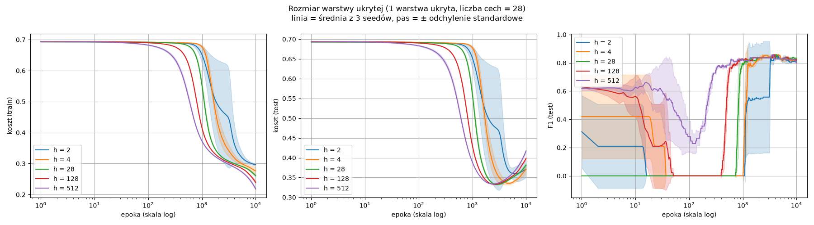
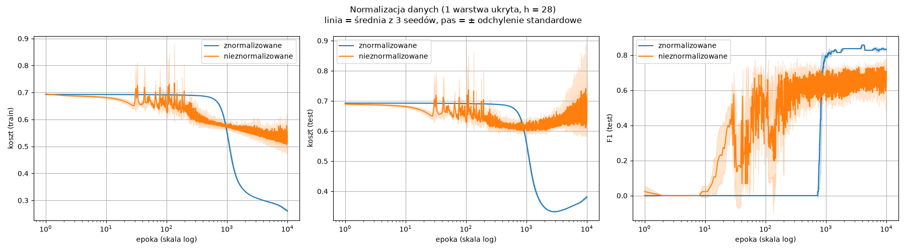
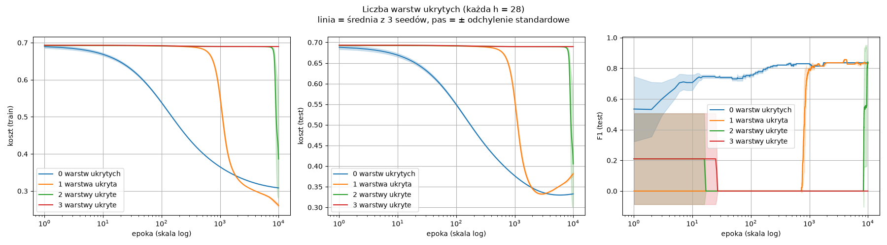
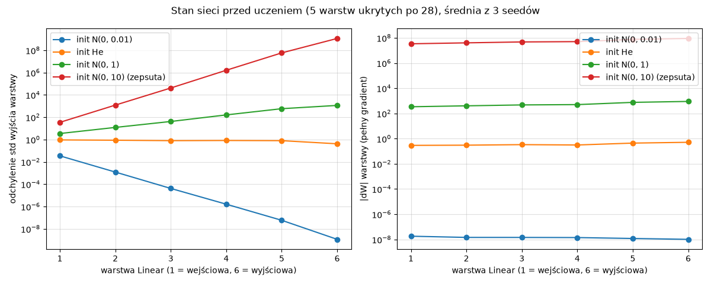
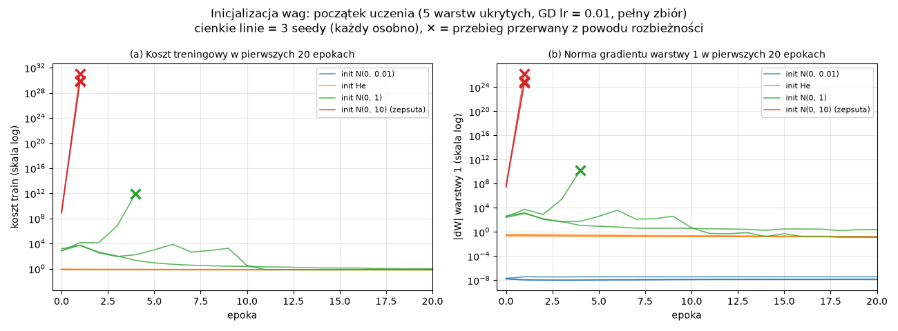
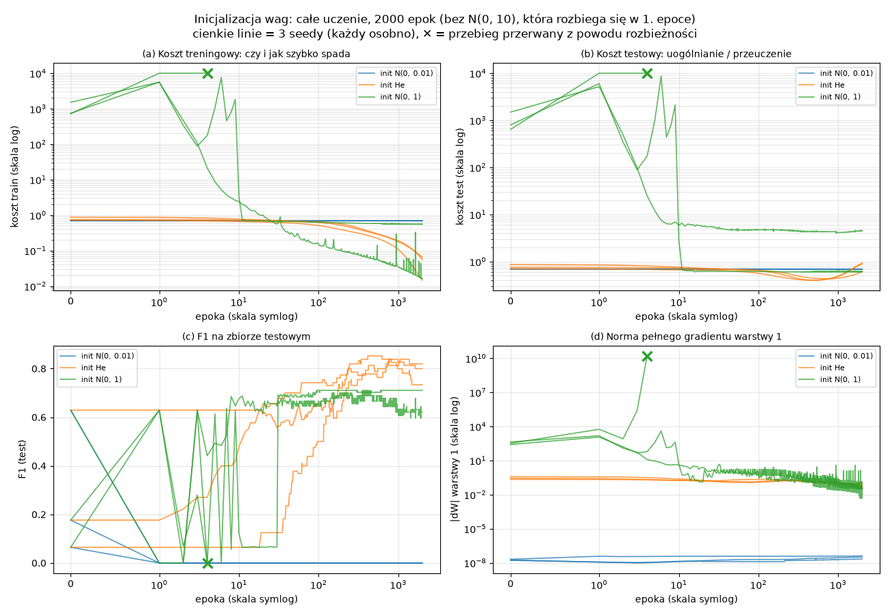
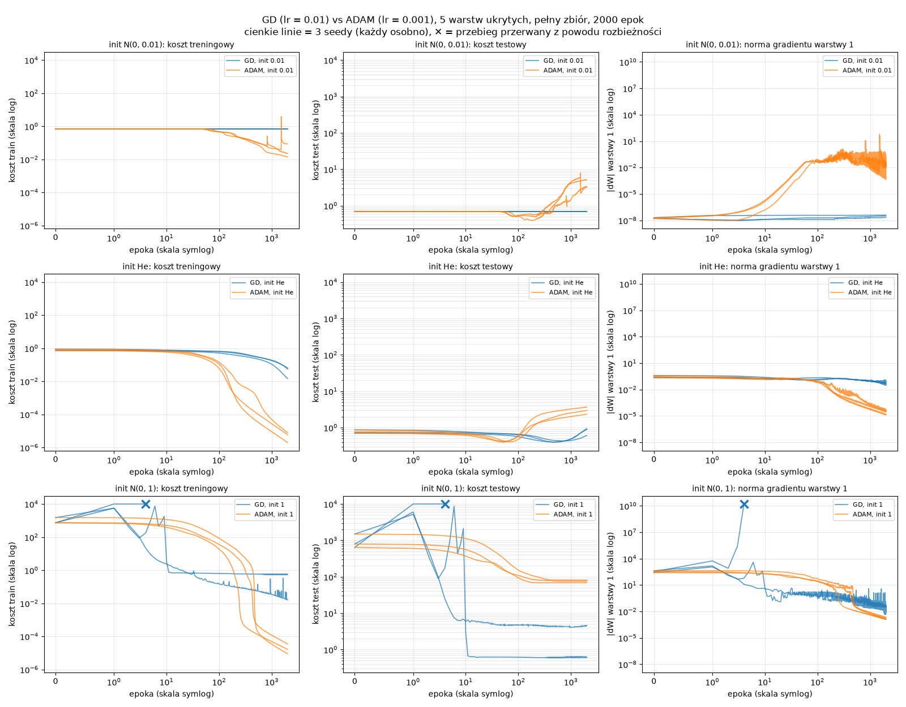
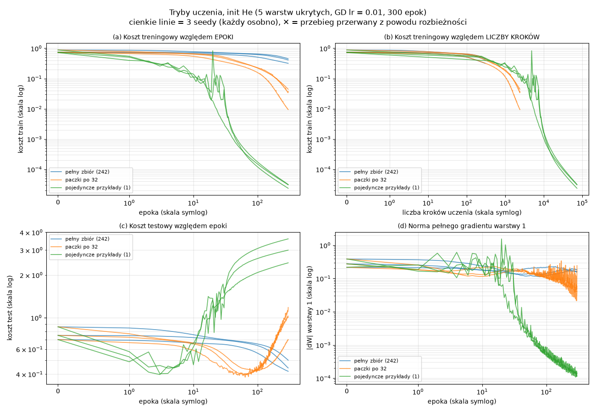
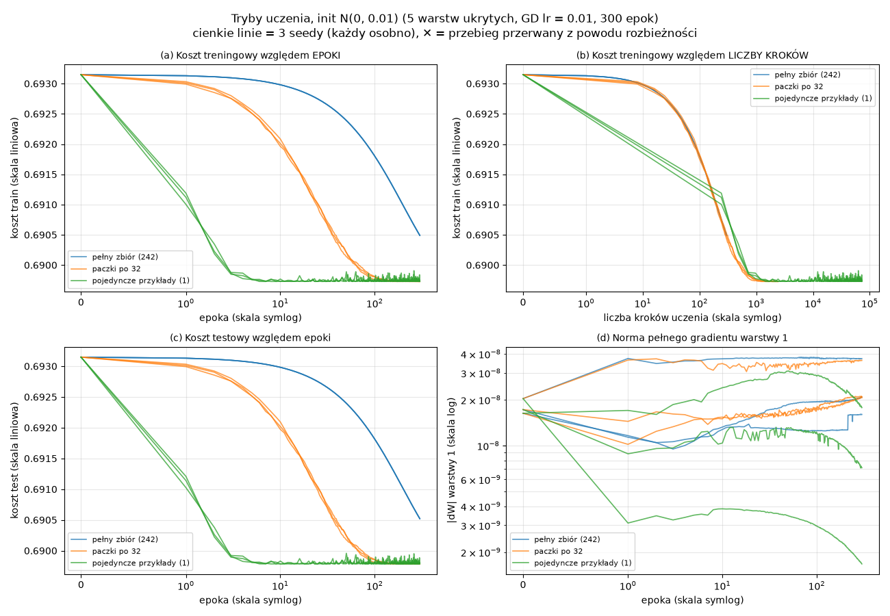

# Sieci neuronowe – ćwiczenie 3: raport

**Pliki:**

| Plik | Zawartość |
|---|---|
| `lab3.py` | część 1: moduły sieci (forward / backward), MLP, eksperymenty 1.4–1.6 |
| `lab3_cz2.py` | część 2: inicjalizacja wag, GD, ADAM, tryby uczenia, eksperymenty 2.4–2.6 (importuje moduły z `lab3.py`) |
| `wyniki.txt`, `wyniki_cz2.txt` | wydruki wyników |
| `wykresy/` | wykresy części 1 (`rozmiar_warstwy`, `normalizacja`, `liczba_warstw`) i części 2 (`cz2_*`) |

---

## Część 1: sieć wielowarstwowa i propagacja wsteczna

### 1.1. Zadanie i model

Zadanie polega na zbudowaniu wielowarstwowej sieci neuronowej (MLP) uczonej **propagacją wsteczną**:
- funkcja aktywacji ReLU w warstwach ukrytych;
- na wyjściu sigmoid i koszt jak w regresji logistycznej (entropia krzyżowa);
- wagi inicjalizowane z N(0, 0.01), współczynnik uczenia 0.01.

**Dane** są przygotowane tak samo jak w lab1/lab2:
- target binarny: 0 = zdrowy, 1 = chory;
- braki uzupełnione dominantą, cechy kategoryczne zakodowane one-hot (28 cech);
- podział 80/20 z tym samym `random_state` co w lab2, czyli 242 próbki treningowe i 61 testowych (28 chorych).

**Implementacja** (`lab3.py`, sam numpy): sieć to sekwencja modułów i każdy ma dwie funkcje:
- `forward(x)` liczy wyjście i zapamiętuje wejście x;
- `backward(dL/dy)` dostaje informację, jak koszt zależy od wyjścia modułu, i zwraca, jak koszt zależy od jego wejścia (dL/dx).
  Moduł z wagami zapisuje przy tym też gradient dL/dW.

| Moduł | forward | backward |
|---|---|---|
| `Linear` | y = Wx + b | dL/dx = dL/dy · W, gradient: dL/dW = (dL/dy)ᵀ · x |
| `ReLU` | max(0, x) | dL/dy · (1 gdy x > 0, inaczej 0) |
| `SigmoidBCELoss` | p = σ(z), koszt −y ln p − (1−y) ln(1−p) | dL/dz = p − y |

Moduły `MLP` układa w kolejności `[Linear → ReLU] × liczba warstw ukrytych → Linear → SigmoidBCELoss`.

**Jedna epoka uczenia** wygląda tak:
1. forward na całym zbiorze treningowym, tak jak w lab2;
2. backward od kosztu do pierwszej warstwy;
3. aktualizacja W ← W − 0.01 · dL/dW.

Uczenie trwa **10 000 epok**. Metryki (accuracy, precision, recall, F1) liczone są na zbiorze testowym po ostatniej epoce.

### 1.2. Decyzje implementacyjne i ich uzasadnienie

**Sigmoid i koszt w jednym module.** Matematycznie to to samo co osobne moduły `Sigmoid` i `BCELoss`:

dL/dz = dL/dp · dp/dz = (p − y) / (p(1 − p)) · p(1 − p) = p − y

Osobno liczy się to jednak gorzej numerycznie. Przykład: gdy sieć jest bardzo pewna złej odpowiedzi
(logit z = 40, pacjent zdrowy), w liczbach float64 σ(40) to dokładnie 1.0. Wtedy osobny `Sigmoid.backward`
zwraca p(1 − p) = 0 i gradient znika, choć sieć myli się maksymalnie. Połączony moduł zwraca p − y = 1.
Ma znaczenie w części 2,gdzie przy dużych wagach początkowych logity są ogromne.

**3 przebiegi (seedy) dla każdej konfiguracji.** Zbiór testowy ma tylko 61 próbek, więc zmiana
klasyfikacji jednego pacjenta zmienia F1 o około 0.015–0.02. Przy jednym przebiegu różnica F1 między
h = 28 a h = 512 (0.828 vs 0.793) wynikała z **dwóch** pacjentów, więc nie dało się stwierdzić, czy to efekt
rozmiaru warstwy, czy przypadkowego losowania wag.

**Koniec plateau.** Sprawdzenie w której epoce koszt treningowy pierwszy raz spada poniżej 0.6
(start to ln 2 ≈ 0.693).

**Metryki po ostatniej epoce, bez wczesnego zatrzymania.** Koszt testowy ma zazwyczaj minimum wcześniej
(około epoki 2500–3000) i potem rośnie. Dlatego metryki są liczone po epoce 10 000, a minimum kosztu
testowego jest tylko informacyjne, żeby pokazać przeuczenie.

### 1.4. Eksperyment 1: rozmiar warstwy ukrytej (h)

Jedna warstwa ukryta z h neuronami. Liczba cech wynosi 28. Wartości to średnia ± odchylenie z 3 seedów.

| h | Koniec plateau (epoka) | Koszt train | Koszt test | Min. koszt test (epoka) | Accuracy | F1 |
|---|---|---|---|---|---|---|
| 2 (znacznie mniej niż cech) | 1882 ± 1094 | 0.296 ± 0.003 | 0.371 ± 0.021 | 0.350 ± 0.019 (4880) | 0.825 ± 0.008 | 0.816 ± 0.004 |
| 4 (znacznie mniej niż cech) | 1360 ± 72 | 0.276 ± 0.013 | 0.371 ± 0.012 | 0.333 ± 0.004 (4543) | 0.836 ± 0.000 | 0.821 ± 0.000 |
| 28 (= liczba cech) | 907 ± 18 | 0.261 ± 0.004 | 0.381 ± 0.005 | 0.332 ± 0.001 (2893) | 0.842 ± 0.008 | **0.832 ± 0.007** |
| 128 (znacznie więcej niż cech) | 609 ± 7 | 0.239 ± 0.005 | 0.399 ± 0.003 | 0.333 ± 0.001 (2610) | 0.831 ± 0.008 | 0.823 ± 0.007 |
| 512 (znacznie więcej niż cech) | 402 ± 14 | 0.218 ± 0.004 | 0.417 ± 0.004 | 0.334 ± 0.000 (2396) | 0.809 ± 0.008 | 0.800 ± 0.010 |



- **Na początku jest plateau.** Przez kilkaset epok koszt stoi na ln 2 ≈ 0.69, czyli na poziomie zgadywania. Wagi są
  tak małe (0.01), że sygnał przechodzący przez dwie warstwy jest bardzo słaby, więc gradienty też są bardzo małe.
- **Im większe h, tym wcześniej sieć wychodzi z plateau:** h = 512 po około 400 epokach, h = 28 po około 900, h = 2 po około 1900.
  Neuron wyjściowy sumuje wyniki h neuronów ukrytych, więc przy większym h jego sygnał (i gradient) jest silniejszy.
- **Przy małym h wynik zależy od losowania wag.** Dla h = 2 koniec plateau różni się między seedami o ±1100 epok
  (szeroki niebieski pas na wykresie). Przy 2 neuronach wystarczy, że jeden zacznie z niekorzystnymi wagami
  (np. ReLU zwraca 0 dla większości pacjentów), a sieć ma mało „zapasu”. Przy h ≥ 28 odchylenie jest małe, bo
  losowe różnice pojedynczych neuronów uśredniają się.
- **Im większe h, tym niższy koszt treningowy** (0.296 → 0.218). Większa sieć ma więcej wag, więc lepiej dopasowuje się do zbioru treningowego.
- **Większe h nie daje lepszego wyniku na teście.** Minimum kosztu testowego jest praktycznie takie samo dla h ≥ 4 (około 0.333),
  a potem koszt rośnie: to **przeuczenie**. Większe sieci przeuczają się wcześniej i mocniej, dlatego po 10 000 epokach
  h = 512 ma najwyższy koszt testowy (0.417) i najniższe F1 (0.800 ± 0.010). Dzięki 3 seedom widać, że ten spadek jest
  powtarzalny, a nie przypadkowy. Jest jednak mały: różnica F1 0.832 vs 0.800 to około 2 pacjentów z 61.
  Nawet 2 neurony wystarczą do F1 ≈ 0.82.

### 1.5. Eksperyment 2: dane znormalizowane i nieznormalizowane

Jedna warstwa ukryta, h = 28. Bez normalizacji cechy liczbowe mają duże wartości, np. chol 126–564 i trestbps 94–200.
Cechy one-hot mają wartości 0/1.

| Dane | Koszt train | Koszt test | Accuracy | Precision | Recall | F1 |
|---|---|---|---|---|---|---|
| znormalizowane | 0.261 ± 0.004 | 0.381 ± 0.005 | 0.842 ± 0.008 | 0.809 ± 0.013 | 0.857 ± 0.000 | **0.832 ± 0.007** |
| nieznormalizowane | 0.529 ± 0.013 | 0.692 ± 0.086 | 0.661 ± 0.047 | 0.634 ± 0.080 | 0.714 ± 0.127 | **0.658 ± 0.019** |



- **Bez normalizacji uczenie jest niestabilne.** Koszt skacze, F1 przez całe uczenie oscyluje między około 0.5 a 0.75,
  a końcowy koszt treningowy (0.529) jest dwa razy wyższy niż dla danych znormalizowanych (0.261).
- **Wynik zależy od momentu zatrzymania i od seeda.** Odchylenie kosztu testowego (± 0.086), precision (± 0.080) i recall (± 0.127)
  jest wielokrotnie większe niż dla danych znormalizowanych. Pod koniec uczenia koszt testowy rośnie, a pas na wykresie się poszerza.
- **Przyczyna:**
  - gradient wag pierwszej warstwy to dL/dW = (dL/dy)ᵀ · x, czyli jest **proporcjonalny do wartości cechy**
  - przy cholesterolu około 250 krok dla tych wag jest setki razy większy niż dla cech 0/1
  - współczynnik uczenia jest wspólny dla wszystkich wag, więc dla dużych cech krok jest za duży (sieć „przeskakuje” minimum),
    a dla małych za mały.
- **Normalizacja jest konieczna.** Wtedy wszystkie cechy mają podobną skalę i jeden współczynnik uczenia pasuje do wszystkich wag.

### 1.6. Eksperyment 3: liczba warstw

Każda warstwa ukryta ma 28 neuronów, dane znormalizowane. „0 warstw ukrytych” oznacza samą regresję logistyczną.

| Warstwy ukryte | Koniec plateau (epoka) | Koszt train | Koszt test | Accuracy | F1 |
|---|---|---|---|---|---|
| 0 | 48 ± 2 | 0.308 ± 0.000 | 0.333 ± 0.000 | 0.852 ± 0.000 | **0.836 ± 0.000** |
| 1 | 907 ± 18 | 0.261 ± 0.004 | 0.381 ± 0.005 | 0.842 ± 0.008 | 0.832 ± 0.007 |
| 2 | 9031 ± 575 | 0.386 ± 0.102 | 0.405 ± 0.096 | 0.852 ± 0.000 | **0.838 ± 0.003** |
| 3 | nie wyszła (0/3 seedów) | 0.690 ± 0.000 | 0.690 ± 0.000 | 0.541 ± 0.000 | 0.000 (nie nauczyła się) |



- **Każda dodatkowa warstwa wielokrotnie wydłuża plateau na początku uczenia:**
  - 0 warstw: koszt spada od pierwszej epoki (poniżej 0.6 po około 50 epokach)
  - 1 warstwa: plateau do około 900 epok
  - 2 warstwy: plateau do około 9000 epok. Po 10 000 epokach sieć jest jeszcze w trakcie spadku kosztu,
    stąd duże odchylenie kosztu (± 0.1): każdy seed jest na innym etapie tego spadku
  - 3 warstwy: plateau trwa przez całe 10 000 epok dla wszystkich 3 seedów. Sieć cały czas mówi „zdrowy”
    dla każdego pacjenta, więc F1 = 0, a accuracy 0.541 to odsetek zdrowych w teście.
- **Przyczyna to zanikanie sygnału.** Każda warstwa mnoży sygnał przez wagi rzędu 0.01. ReLU zeruje mniej więcej
  połowę neuronów, więc do następnej warstwy realnie dochodzi sygnał z około 14 z 28 wejść. W backward gradient przechodzi
  przez te same małe wagi, więc też słabnie. Przy 3 warstwach gradient w pierwszej warstwie
  jest tak mały, że wagi praktycznie się nie zmieniają.
- **Kiedy sieć wyjdzie z plateau, osiąga taki sam wynik jak regresja logistyczna** (F1 ≈ 0.83–0.84). Dodatkowe warstwy
  nie poprawiają wyniku, a 1 warstwa po dłuższym uczeniu zaczyna się przeuczać (koszt test rośnie od około 2900. epoki).

### 1.7. Wnioski z części 1

- **Rozmiar warstwy ukrytej** wpływa głównie na szybkość uczenia i skłonność do przeuczenia:
  większe h szybciej wychodzi z plateau, ale mocniej się przeucza. Wynik końcowy różni się niewiele:
  F1 od 0.800 ± 0.010 (h = 512) do 0.832 ± 0.007 (h = 28).
- **Normalizacja danych jest niezbędna.** Bez niej uczenie jest niestabilne, wynik silnie zależy od seeda,
  a F1 spada z 0.832 do 0.658.
- **Liczba warstw przy inicjalizacji N(0, 0.01) jest krytyczna.** Każda kolejna warstwa wydłuża plateau około 10–20 razy (50 → 900 → 9000 epok),
  a sieć z 3 warstwami ukrytymi nie nauczyła się wcale w 10 000 epok dla żadnego seeda.
  To problem zanikających gradientów, którym zajmuje się część 2 (inicjalizacja He, optymalizator ADAM).
- **Na Heart Disease sieć wielowarstwowa nie jest lepsza od regresji logistycznej** (F1 ≈ 0.836 w obu przypadkach).
  Zbiór nie jest liniowo separowalny: regresja logistyczna kończy z kosztem treningowym około 0.31
  i myli się na około 15% pacjentów testowych. Zależność jest jednak w przybliżeniu liniowa, więc model liniowy wyciąga
  prawie całą informację, a dodatkowe warstwy nie mają czego się „nauczyć” ponad niego.

---

## Część 2: optymalizacja – ADAM, tryby uczenia, inicjalizacja wag

### 2.1. Zadanie

- optymalizator **ADAM**
- uczenie w trzech trybach: **pełny zbiór**, **paczki** (mini-batch) i **pojedyncze przykłady** (SGD)
- **wybór inicjalizacji wag**: N(0, 1), He oraz inicjalizacja celowo „zepsuta”.

### 2.2. Implementacja

**Kod:** `lab3_cz2.py`, wyniki w `wyniki_cz2.txt`, wykresy `wykresy/cz2_*.png`.

Moduły sieci (`Linear`, `ReLU`, `SigmoidBCELoss`, `MLP`) i przygotowanie danych są **importowane z `lab3.py`** z części 1.
Dzięki temu część 2 korzysta z tego samego, sprawdzonego testem numerycznym backwardu (sekcja 1.3),
a dane i podział train/test są identyczne. Nowy kod to tylko inicjalizacja, optymalizatory i pętla uczenia.

**Inicjalizacja wag.** Funkcja `init_weights(model, init, seed)` losuje wagi każdej warstwy `Linear` od nowa:

| init | Rozkład wag W | Uwagi |
|---|---|---|
| `0.01` | N(0, 0.01) | jak w części 1, zanikanie sygnału |
| `"he"` | N(0, √(2/d_in)) | d_in = liczba wejść warstwy, więc każda warstwa ma inne odchylenie |
| `1.0` | N(0, 1) | wymagane w treści |
| `10.0` | N(0, 10) | inicjalizacja „zepsuta”: bardzo duże odchylenie |

**Optymalizatory.** Oba mają metodę `step(model)`, która aktualizuje W i b każdej warstwy `Linear` na podstawie dW i db obliczonych w backward.

- **`GD(lr)`**: w ← w − lr · g, jak w części 1.
- **`Adam(lr, β1 = 0.9, β2 = 0.999, ε = 10⁻⁸)`**: dla **każdej wagi z osobna** trzyma m i v (startują od zera):

  ```
  m = β1·m + (1 − β1)·g          (średnia krocząca gradientu: momentum)
  v = β2·v + (1 − β2)·g²         (średnia krocząca kwadratu gradientu: „wielkość” kroków)
  m̂ = m / (1 − β1ᵗ),   v̂ = v / (1 − β2ᵗ)     (korekcja biasu, bo m i v startują od zera)
  w = w − lr · m̂ / (√v̂ + ε)
  ```

**Tryby uczenia.** `train(..., batch_size)`: `None` to pełny zbiór (1 krok na epokę), `32` to paczki po 32 (8 kroków na epokę),
a `1` to pojedyncze przykłady (242 kroki na epokę). Przykłady są tasowane na początku każdej epoki.
Koszt w trakcie paczki liczony jest jako średnia po przykładach w paczce, tak jak w części 1 po całym zbiorze.

### 2.3. Decyzje dotyczące eksperymentów

- **Głębokość: 5 warstw ukrytych po 28 neuronów.** W części 1 już 3 warstwy z init 0.01 nie uczyły się wcale.
  Przy 5 warstwach skala sygnału zmienia się 5 razy (co warstwę), więc różnice między inicjalizacjami są bardzo wyraźne.
  Przy 1–2 warstwach wszystkie inicjalizacje dałyby podobny wynik i problemów nie byłoby widać.
- **Współczynnik uczenia:** GD lr = 0.01 (jak w części 1), ADAM lr = 0.001 (standardowa wartość z literatury).
  ADAM ma więc 10× **mniejszy** lr niż GD, więc jego przewaga w eksperymentach nie wynika z większego kroku.
- **Warunek stopu: stały budżet epok** (2000 dla inicjalizacji i GD vs ADAM, 300 dla trybów).
  Celowo **nie** używam warunku z lab2 (|ΔL| < tol), bo na plateau zatrzymałby uczenie i uznał je za zbieżność.
  Pokazuję to w tabelach (kolumna „Stop |ΔL| < 10⁻⁶”): w której epoce zatrzymałby się ten warunek i z jakim kosztem.
- **Rozbieżność:** przebieg jest przerywany, gdy koszt treningowy jest nieskończony albo ponad 10⁴ razy większy niż przed uczeniem.
  Sam test na NaN nie wystarcza: stabilny wzór kosztu z części 1 daje skończone, ale absurdalne wartości (np. 10²⁸⁷).
  Koszty rozbieżnych przebiegów są pomijane w średnich, a ich liczba jest podana osobno.
- **Koszt mierzony na całym zbiorze treningowym po każdej epoce**, niezależnie od trybu, żeby krzywe były porównywalne.
  W epoce 0 (przed uczeniem) zapisywany jest koszt startowy. Oś X jest w skali symlog, czyli logarytmicznej, ale z widocznym punktem 0.
- **Norma pełnego gradientu |dW| pierwszej warstwy** (osobny panel na każdym wykresie) pokazuje bezpośrednio
  zanikanie lub eksplozję gradientu.
- **3 seedy** (0, 1, 2) dla każdej konfiguracji. W tabelach: średnia ± odchylenie, jak w części 1.
  **Na wykresach każdy seed jest osobną cienką linią** (zamiast średniej z pasem jak w części 1). Powód: gdy jeden z trzech
  przebiegów się rozbiega, jego koszt (np. 10¹⁰) „ciągnie” średnią w górę i na wykresie powstaje sztuczny pik, a po przerwaniu
  tego przebiegu średnia nagle liczy się już tylko z dwóch. Osobne linie pokazują dokładnie, co zrobił każdy przebieg.
- **„Koniec plateau”** = pierwsza epoka, w której koszt treningowy spada poniżej 0.6 (start: ln 2 ≈ 0.693), jak w części 1.
- **W tej części oceniam głównie koszt treningowy**, bo pytanie dotyczy optymalizacji, czyli tego, jak szybko i czy w ogóle
  optymalizator schodzi w dół. Koszt testowy i F1 podaję pomocniczo. Sieć z 5 warstwami jest bardzo duża jak na 242 próbki,
  więc dobre optymalizatory mocno się przeuczają (szczegóły w sekcji 2.7).

### 2.4. Eksperyment 4: inicjalizacja wag

5 warstw ukrytych, zwykły GD lr = 0.01, pełny zbiór, 2000 epok.

#### 2.4.1. Stan sieci przed uczeniem



| init | Zmiana skali sygnału na warstwę | Std wyjścia sieci | \|dW\| warstwy 1 | Koszt startowy |
|---|---|---|---|---|
| N(0, 0.01) | maleje około 27× | około 10⁻⁹ | 1.8·10⁻⁸ | 0.693 |
| **He** | **stała, około 1** | około 0.3 | 0.29 | 0.78 ± 0.07 |
| N(0, 1) | rośnie około 3.7× | około 10³ | 340 | 995 ± 370 |
| N(0, 10) | rośnie około 37× | około 10⁹ | 3.4·10⁷ | 10⁹ (9.95·10⁸ ± 3.7·10⁸) |


- **Skąd te liczby:** wyjście neuronu to suma 28 iloczynów waga × wejście. ReLU zeruje mniej więcej połowę wejść,
  więc odchylenie wyjścia warstwy ≈ std_wag · √(28/2) · odchylenie wejścia ≈ std_wag · 3.7 · odchylenie wejścia:
  - 0.01 · 3.7 ≈ 0.037, czyli sygnał maleje około 27× na warstwę (to samo, co oszacowanie w sekcji 1.6);
  - 1 · 3.7 = 3.7, czyli rośnie 3.7× na warstwę;
  - 10 · 3.7 = 37, czyli rośnie 37× na warstwę.
  Pomiar na wykresie dokładnie odpowiada tym wartościom.
- **He dobiera std = √(2/28) ≈ 0.27, tak żeby ten iloczyn był równy 1.** Jako jedyna zachowuje skalę sygnału przez wszystkie warstwy.

#### 2.4.2. Uczenie

Wyniki pokazuję na **dwóch osobnych wykresach**. Inicjalizacja N(0, 10) rozbiega się już w 1. epoce i jej koszt dochodzi do 10³⁰.
Na jednym wspólnym wykresie oś Y musiałaby sięgać 10³⁰, a różnice między pozostałymi inicjalizacjami (koszty od 0.02 do 1)
zlałyby się w jedną płaską linię na dole. Dlatego:
- **pierwszy wykres** pokazuje tylko **pierwsze 20 epok** wszystkich czterech inicjalizacji, czyli moment, w którym N(0, 10) i N(0, 1) wybuchają;
- **drugi wykres** pokazuje **całe uczenie (2000 epok) bez N(0, 10)**, z osią kosztu ograniczoną do 10⁻⁶ – 10⁴.

**Wykres 1: początek uczenia (pierwsze 20 epok, oś X liniowa).**
(a) koszt treningowy, (b) norma gradientu pierwszej warstwy.



- **Czerwona linia (N(0, 10)) to tylko odcinek od epoki 0 do 1 zakończony ✕.** Przed uczeniem koszt wynosi około 10⁹, gradient
  pierwszej warstwy około 3·10⁷. Pierwszy krok GD (0.01 · gradient) zmienia wagi o tysiące, koszt skacze do około 10³⁰,
  czyli ponad 10⁴ razy więcej niż na starcie, więc przebieg jest przerywany jako rozbieżny. **Po 1. epoce nie ma już czego rysować**
  i dlatego linia się urywa. Tak samo dla wszystkich 3 seedów (trzy ✕ prawie w jednym miejscu).
- **Zielona (N(0, 1))**: koszt startowy około 1000, gradient około 340. W 1. epoce koszt **rośnie** (do około 10⁴), bo krok jest za duży.
  Jeden seed rozbiega się w 4. epoce (✕), dwa pozostałe po kilku–kilkunastu epokach „spadają” do kosztu poniżej 1.
- **Pomarańczowa (He) i niebieska (0.01)** są przy tej skali płaskie na poziomie około 0.7: w pierwszych 20 epokach nic się nie dzieje.
  Różnica między nimi jest widoczna dopiero na panelu (b): gradient He około 0.3, a 0.01 około 10⁻⁸.

**Wykres 2: całe uczenie, 2000 epok, bez N(0, 10).**
(a) koszt treningowy, (b) koszt testowy, (c) F1 na zbiorze testowym, (d) norma gradientu pierwszej warstwy.



| init | Koszt startowy | Koszt po 1. epoce | Maks. koszt | Rozbieżność | Koniec plateau (epoka) | Stop \|ΔL\| < 10⁻⁶ (epoka, koszt) | Koszt train (koniec) | Min. koszt test | F1 |
|---|---|---|---|---|---|---|---|---|---|
| N(0, 0.01) | 0.693 | 0.693 | 0.693 | 0/3 | nie wyszła (0/3) | **569, koszt 0.690** | 0.690 ± 0.000 | 0.690 | 0.000 ± 0.000 |
| **He** | 0.78 | 0.77 | 0.78 | 0/3 | **107 ± 48** | nie zatrzymałby się | **0.045 ± 0.022** | 0.409 ± 0.014 | 0.784 ± 0.037 |
| N(0, 1) | 995 | 8.5·10³ | 3·10¹¹ | **1/3 (epoka 4)** | 126 ± 98 (2/3 seedów) | 265 ± 172, koszt 0.37 ± 0.21 | 0.284 ± 0.268 | 2.31 ± 1.71 | 0.444 ± 0.316 |
| N(0, 10) | 10⁹ | **4·10³⁰** | 4·10³⁰ | **3/3 (epoka 1)** | nie wyszła (0/3) | — | — | — | 0.419 ± 0.297 |

Koszty na końcu uczenia dla N(0, 1) są średnią z 2 seedów, które się nie rozbiegły. Kolumny „koszt startowy”, „po 1. epoce”
i „maks. koszt” (średnie z 3 seedów) pokazują, co się dzieje z zepsutymi inicjalizacjami. Dla N(0, 10) to jedyne sensowne liczby,
bo uczenie kończy się po 1 kroku: koszt rośnie z 10⁹ do 4·10³⁰, czyli **około 10²¹ razy w jednym kroku**.

- **N(0, 0.01): zanikające gradienty.** Gradient około 10⁻⁸ i lr = 0.01 dają kroki rzędu 10⁻¹⁰, więc wagi stoją w miejscu.
  Na wykresie 2 niebieskie linie są płaskie na 0.69 przez całe 2000 epok, F1 = 0 (sieć mówi „zdrowy” każdemu), a gradient (d)
  cały czas około 10⁻⁸. **Warunek stopu z lab2 zatrzymałby uczenie w epoce 569 i uznał je za zbieżne**, choć sieć niczego się
  nie nauczyła. To przykład płaskowyżu, o którym mówi treść zadania.
- **He: sieć uczy się od razu i niezawodnie.** Wszystkie 3 seedy wychodzą z plateau (średnio w 107. epoce, jeden wyraźnie później
  od pozostałych) i schodzą z kosztem treningowym do 0.02–0.06. Gradient (d) przez całe uczenie ma zdrową wielkość około 0.1–1.
  Koszt testowy (b) ma minimum około epoki 300–600 i potem rośnie (przeuczenie, sekcja 2.7).
- **N(0, 1): eksplodujące gradienty, wynik zależy od losowania wag.**
  - koszt startowy około 1000 i gradient pierwszej warstwy około 340, więc kroki GD są za duże i w 1. epoce koszt **rośnie**
    średnio do 8.5·10³;
  - 1 z 3 seedów rozbiegł się w 4. epoce (✕ na górnej krawędzi wykresu 2 i na wykresie 1);
  - 2 pozostałe „wygrzebały się” po około 10 epokach, ale skończyły zupełnie inaczej: jeden zszedł z kosztem treningowym do 0.02,
    ale ma koszt testowy około 4.5 (duże wagi, bardzo pewne i często błędne odpowiedzi), drugi utknął na koszcie treningowym
    około 0.55 z kosztem testowym około 0.6. Stąd ogromne odchylenia w tabeli (koszt test 2.31 ± 1.71, F1 0.444 ± 0.316);
  - **przy N(0, 1) wynik jest kwestią szczęścia**: trzy seedy dały trzy zupełnie różne wyniki.
- **N(0, 10) (zepsuta): natychmiastowa rozbieżność** (wykres 1, opis wyżej). F1 = 0.629 dla dwóch seedów nic nie znaczy:
  sieć mówi „chory” dla każdego pacjenta, a wtedy F1 = 2·28 / (61 + 28) = 0.629. Dlatego dla tej inicjalizacji patrzymy na koszt
  i rozbieżność, a nie na F1.

### 2.5. Eksperyment 5: zwykły gradient vs ADAM

5 warstw ukrytych, pełny zbiór, 2000 epok. GD lr = 0.01, ADAM lr = 0.001.

Wykres ma układ 3 × 3: **wiersz = inicjalizacja** (N(0, 0.01), He, N(0, 1)), **kolumna = co mierzymy** (koszt treningowy,
koszt testowy, norma gradientu warstwy 1). W każdym panelu są tylko dwa kolory: **niebieski = GD, pomarańczowy = ADAM**,
więc porównanie optymalizatorów przy tej samej inicjalizacji jest bezpośrednie. Panele w jednej kolumnie mają tę samą skalę osi Y.



| Optymalizator, init | Koniec plateau (epoka) | Rozbieżność | Koszt train | Koszt test | Min. koszt test | F1 |
|---|---|---|---|---|---|---|
| GD, 0.01 | nie wyszła (0/3) | 0/3 | 0.690 ± 0.000 | 0.690 | 0.690 | 0.000 ± 0.000 |
| **ADAM, 0.01** | **67 ± 7** | 0/3 | 0.040 ± 0.032 | 3.94 ± 0.88 | 0.463 ± 0.053 | 0.764 ± 0.024 |
| GD, He | 107 ± 48 | 0/3 | 0.045 ± 0.022 | 0.81 ± 0.14 | 0.409 ± 0.014 | 0.784 ± 0.037 |
| **ADAM, He** | **15 ± 6** | 0/3 | 0.000005 ± 0.000002 | 2.97 ± 0.55 | 0.407 ± 0.011 | 0.756 ± 0.009 |
| GD, 1 | 126 ± 98 (2/3) | 1/3 | 0.284 ± 0.268 | 2.56 ± 1.95 | 2.31 ± 1.71 | 0.444 ± 0.316 |
| ADAM, 1 | 324 ± 103 | **0/3** | 0.00002 ± 0.00001 | 75 ± 5 | 74.3 ± 4.5 | 0.659 ± 0.035 |

- **ADAM wychodzi z płaskowyżu, na którym GD stoi.** Przy init 0.01 GD nie ruszył przez 2000 epok, a ADAM wyszedł
  z plateau po około 67 epokach dla każdego seeda, mimo 10× mniejszego lr. Przyczyna: ADAM dzieli krok przez √v̂, czyli przez typową
  wielkość gradientu. Gradient 10⁻⁸ jest dzielony przez około 10⁻⁸, więc krok ma długość około lr = 0.001, a nie 10⁻¹⁰ jak w GD.
  Na wykresie normy gradientu widać, że ADAM „wyciąga” sieć z obszaru zanikających gradientów:
  |dW| rośnie od 10⁻⁸ do około 10⁻² w ciągu 100 epok i dopiero wtedy zaczyna spadać koszt.
  To połączenie obu mechanizmów z treści: skalowanie przez odwrotność wielkości gradientu oraz momentum, które utrzymuje kierunek.
- **Przy dobrej inicjalizacji ADAM jest po prostu szybszy:** z He wychodzi z plateau w 15 epokach zamiast 107
  i schodzi z kosztem treningowym do 5·10⁻⁶, czyli praktycznie zapamiętuje zbiór treningowy.
- **ADAM nie rozbiega się przy dużych wagach.** Przy N(0, 1) GD rozbiegł się w 1 z 3 przebiegów, a ADAM w żadnym,
  bo długość jego kroku jest ograniczona przez lr niezależnie od wielkości gradientu (około 10³).
  Ta sama własność ma jednak koszt: ADAM uczy się przy N(0, 1) **wolno** (plateau do epoki około 324), bo przy krokach 0.001
  potrzebuje setek kroków, żeby zmienić wagi rzędu 1. Sieć kończy z ogromnymi wagami i bardzo pewnymi odpowiedziami:
  koszt treningowy 0.00002, ale testowy 75, bo każdy błąd na teście jest „pewny na 100%” i kosztuje bardzo dużo.
  **ADAM nie naprawia złej inicjalizacji, tylko chroni przed rozbieżnością.**
- **Najlepszy koszt testowy (minimum w trakcie uczenia) jest podobny dla ADAM i GD z dobrą inicjalizacją** (około 0.41).
  ADAM dochodzi do niego szybciej, a potem szybciej się przeucza.
- **ADAM ma skoki kosztu w późnej fazie uczenia** (górny lewy panel: przy init 0.01 koszt treningowy jednego seeda skacze
  około epoki 1500 nawet do około 4, maksymalny koszt w tej konfiguracji to 1.76 ± 1.51, więcej niż na starcie).
  Gdy gradienty robią się bardzo małe, v̂ też maleje, a wtedy pojedynczy większy gradient daje krok wyraźnie dłuższy niż lr.
  To znana cecha ADAM; sieć szybko wraca na dawny poziom kosztu.

### 2.6. Eksperyment 6: tryby uczenia (pełny zbiór, paczki, pojedyncze przykłady)

5 warstw ukrytych, zwykły GD lr = 0.01, **300 epok**, czyli każdy tryb widzi te same dane tyle samo razy.
Liczba kroków w 300 epokach to 300 dla pełnego zbioru, 2400 dla paczek i 72 600 dla pojedynczych przykładów.

Każdy wykres trybów ma 4 panele:
- **(a) koszt treningowy względem epoki** – kto szybciej schodzi w dół, jeśli każdy tryb przejrzy dane tyle samo razy;
- **(b) ten sam koszt treningowy, ale względem liczby kroków** (aktualizacji wag) – kto szybciej schodzi w dół na jeden krok.
  Linie kończą się w różnych miejscach, bo w 300 epokach pełny zbiór robi 300 kroków, paczki 2400, a SGD 72 600;
- **(c) koszt testowy względem epoki** – uogólnianie i moment przeuczenia;
- **(d) norma pełnego gradientu pierwszej warstwy**.

F1 jest tylko w tabelach: przy 3 trybach × 3 seedy krzywe F1 były zbyt poszarpane, żeby coś z nich odczytać.

#### 2.6.1. Inicjalizacja He



| Tryb | Kroków na epokę | Koniec plateau (epoka) | Koszt train | Koszt test | Min. koszt test | F1 | Czas przebiegu |
|---|---|---|---|---|---|---|---|
| pełny zbiór | 1 | 107 ± 48 | 0.393 ± 0.055 | 0.454 ± 0.035 | 0.454 ± 0.035 | 0.779 ± 0.037 | 0.3 s |
| paczki po 32 | 8 | 14 ± 6 | 0.031 ± 0.015 | 0.96 ± 0.20 | 0.400 ± 0.018 | 0.779 ± 0.037 | 0.5 s |
| pojedyncze przykłady | 242 | 1 ± 0 | 0.00003 ± 0.000004 | 3.01 ± 0.47 | 0.413 ± 0.020 | 0.747 ± 0.025 | 6.3 s |

- **Na jedną epokę mniejsze paczki uczą dużo szybciej:** plateau kończy się w 1. epoce (SGD), w 14. (paczki) i w 107. (pełny zbiór).
  Wynika to głównie z liczby kroków: w jednej epoce SGD robi 242 kroki, a pełny zbiór tylko 1.
- **Na jeden krok tryby są podobne (panel b).** Względem liczby kroków krzywe paczek i SGD leżą blisko siebie aż do około 1000 kroków,
  a pełny zbiór po prostu kończy się wcześniej (po 300 krokach). Krok liczony z 1 lub 32 przykładów jest tylko przybliżeniem pełnego
  gradientu, ale przy tej wielkości lr prowadzi w podobnym kierunku. Przewaga małych paczek „na epokę” bierze się więc głównie
  z **liczby kroków**. Najwyraźniej widać to przy init 0.01 (sekcja 2.6.2).
- **SGD jest zaszumiony.** Koszt treningowy SGD ma wyraźne skoki (około 20.–40. epoki), a pełny gradient spada gładko.
  Za to przy pełnym zbiorze trzy seedy są wyraźnie rozsunięte w środku uczenia: moment wyjścia z plateau zależy od wylosowanych
  wag (107 ± 48). W SGD setki zaszumionych kroków szybko wyrównują różnice startowe (1 ± 0).
- **Czas obliczeń:** pełny zbiór i paczki są najtańsze. SGD jest około 20× wolniejszy na epokę, bo robi 242 małe operacje
  zamiast jednej dużej, a numpy jest wydajny na dużych macierzach. **Paczki są najlepszym kompromisem**:
  szybko schodzą z kosztem przy niemal tym samym czasie co pełny zbiór.
- **Szybsza optymalizacja = szybsze przeuczenie.** SGD zapamiętuje zbiór treningowy (koszt 0.00003), ale koszt testowy rośnie do 3.
  Minimum kosztu testowego jest podobne dla wszystkich trybów (0.40–0.45), różni się tylko moment, w którym występuje.

#### 2.6.2. Inicjalizacja N(0, 0.01): czy szum SGD wyciąga z płaskowyżu?



| Tryb | Koniec plateau | Stop \|ΔL\| < 10⁻⁶ | Koszt train | F1 |
|---|---|---|---|---|
| pełny zbiór | nie wyszła (0/3) | — | 0.690 | 0.000 |
| paczki po 32 | nie wyszła (0/3) | epoka 82 ± 12 | 0.690 | 0.000 |
| pojedyncze przykłady | nie wyszła (0/3) | epoka 9 ± 2 | 0.690 | 0.000 |

- **Żaden tryb nie wyszedł z płaskowyżu.** 
- **Koszt spadł z 0.6931 do 0.6898 i tam utknął.** 
- **Na krok wszystkie tryby robią dokładnie to samo** (panel b, oś Y liniowa): krzywe pełnego zbioru i paczek względem liczby kroków
  praktycznie się pokrywają, a SGD dochodzi do 0.6898 po tej samej liczbie około 1000 kroków. To najczystszy dowód, że przewaga
  małych paczek „na epokę” to po prostu więcej kroków na epokę.
- **SGD szybciej (w epokach) dochodzi do tego fałszywego minimum** (około 10 epok, a pełny zbiór nie dochodzi do niego w 300).
  Warunek stopu |ΔL| < 10⁻⁶ zatrzymałby SGD już w epoce 9, co dobrze pokazuje, dlaczego na płaskowyżu łatwo uznać uczenie za zakończone.

### 2.7. Uwaga o przeuczeniu

Sieć z 5 warstwami ukrytymi po 28 neuronów ma około 4000 wag, a zbiór treningowy 242 przykłady.
Każdy optymalizator, który dobrze działa (ADAM, He, SGD, paczki), po pewnym czasie zapamiętuje zbiór treningowy
(koszt train rzędu 10⁻⁵) i koszt testowy rośnie. Minimum kosztu testowego wynosi około 0.40–0.46, czyli gorzej niż
dla płytkiej sieci z części 1 (0.33). To nie jest problem optymalizacji, tylko zbyt dużego modelu dla tego zbioru.
W tej części celowo nie stosuję wczesnego zatrzymania, bo celem jest porównanie przebiegu optymalizacji, a nie najlepsze F1.

### 2.8. Wnioski z części 2

- **Inicjalizacja decyduje, czy głęboka sieć w ogóle zacznie się uczyć.** Przy 5 warstwach:
  - N(0, 0.01): gradienty zanikają (około 10⁻⁸), sieć stoi na płaskowyżu;
  - N(0, 1): gradienty eksplodują, wynik zależy od losowania wag (1 z 3 przebiegów rozbiegł się);
  - N(0, 10): natychmiastowa rozbieżność;
  - **He zachowuje skalę sygnału w każdej warstwie i jako jedyna działa niezawodnie.**
- **ADAM rozwiązuje problem płaskowyżu:** dzięki skalowaniu kroku przez wielkość gradientu wyszedł z plateau, na którym
  GD stał przez 2000 epok, mimo 10× mniejszego lr. Przy dobrej inicjalizacji jest kilka razy szybszy od GD i chroni przed
  rozbieżnością przy dużych wagach. Nie naprawia jednak złej inicjalizacji: przy N(0, 1) uczy się wolno i daje bardzo pewny siebie,
  przeuczony model.
- **Tryby uczenia:** na epokę paczki i SGD są dużo szybsze od pełnego zbioru, bo robią więcej kroków.
  Na krok różnica jest mała, a SGD jest najwolniejszy w czasie rzeczywistym i najbardziej zaszumiony.
  Szum z paczek **nie wystarczył**, żeby wyjść z płaskowyżu przy zanikających gradientach.
  Najlepszym kompromisem są paczki.
- **Warunek stopu |ΔL| < tol jest zdradliwy w sieciach głębokich:** na płaskowyżu koszt prawie się nie zmienia,
  więc warunek uznaje uczenie za zakończone (epoka 569 dla GD z init 0.01, epoka 9 dla SGD), choć sieć niczego się nie nauczyła.
  Dlatego w eksperymentach użyłem stałego budżetu epok.
- **Połączenie He + ADAM** (+ paczki) daje najszybszą i najbardziej niezawodną optymalizację, i dlatego jest standardem
  w uczeniu głębokim. Problem zanikających gradientów, przez który w części 1 sieć z 3 warstwami i inicjalizacją N(0, 0.01)
  nie nauczyła się niczego w 10 000 epok, ADAM rozwiązał tutaj nawet dla 5 warstw (w 67 epok), a He w ogóle go eliminuje.
